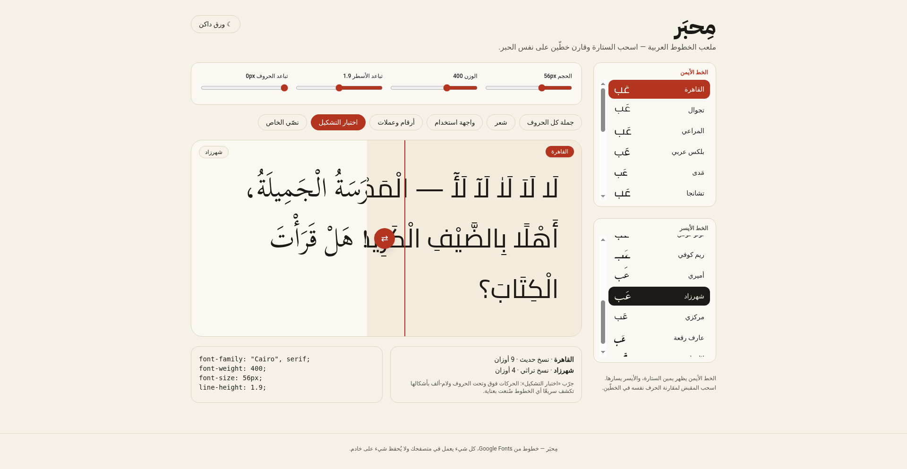

# Mihbar (مِحبَر) - Arabic Type Playground

An Arabic-first typography lab: try Arabic web fonts on real texts, tune size, weight and rhythm, and compare any two fonts on the same ink. The whole UI is Arabic and RTL-native, because the tool is for the script itself.

**Live demo:** https://malakmo7amed309.github.io/arabic-type-playground/



## Standout feature

The comparison curtain. Two fonts render the exact same text in one stage, split by a draggable divider (pointer events, works with mouse and touch), so you can drag across a word and watch the same letters change voice - stroke by stroke. Pair that with the tashkeel stress-test sample (full diacritics, shadda stacks, every lam-alef form) and weak fonts expose themselves in seconds.

## What's inside

- 14 curated Arabic Google Fonts across naskh, kufi, ruqaa and display styles, each labeled with its style class and real weight range
- Draggable split curtain comparing two fonts on identical text, with synced controls
- Sample texts: an all-letters pangram, classical poetry, real UI microcopy, numbers and currencies (Arabic-Indic and Latin digits), and the tashkeel stress test
- Size, weight (clamped to what each font actually ships), line-height and letter-spacing sliders - letter-spacing carries a warning because it breaks Arabic letter joining
- Custom text box with instant preview
- Paper / dark-paper themes, font style chips rendered in their own face
- Loads only the fonts in play from Google Fonts; everything else is local, nothing leaves the browser

## Stack

React 19, Tailwind CSS 4, Vite (single-file build, no backend). Fonts load at runtime from the Google Fonts API; state persists in localStorage.

## Run locally

```
npm install
npm run dev
```

Build outputs a single self-contained `dist/index.html` (what GitHub Pages serves from `docs/`).
